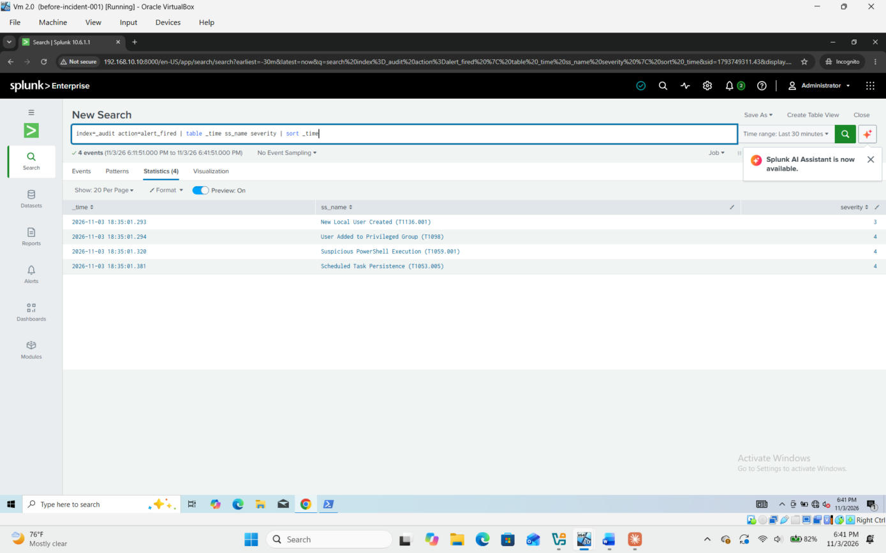
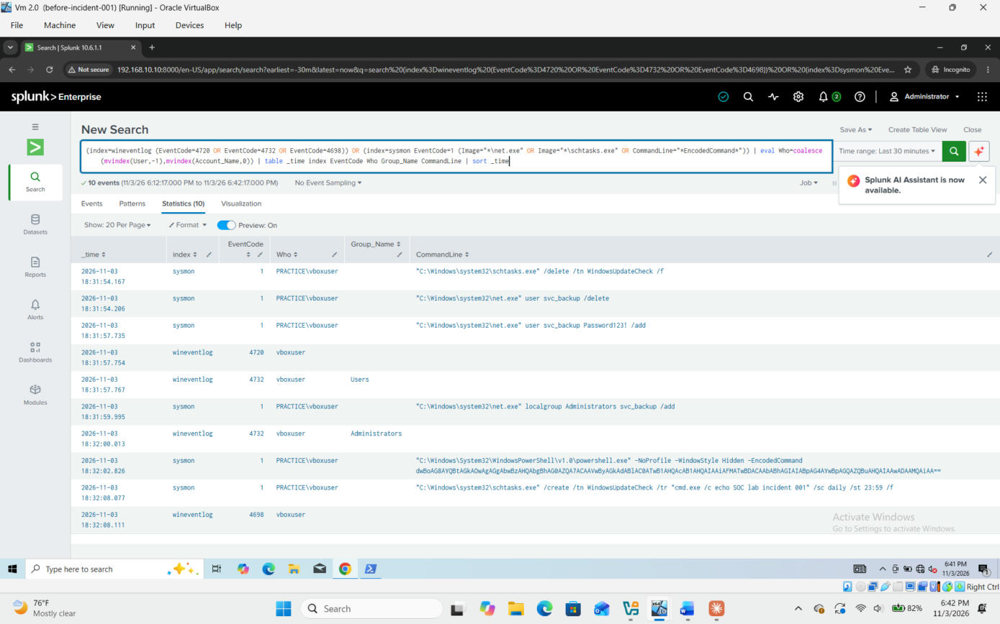
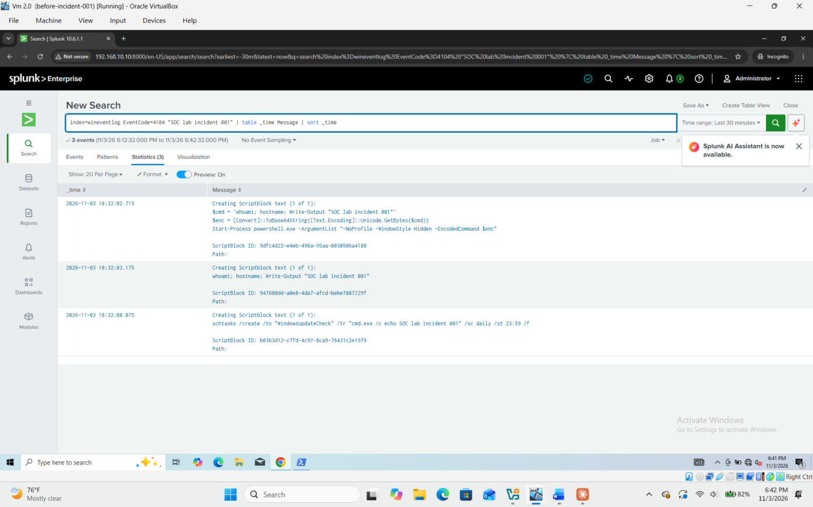
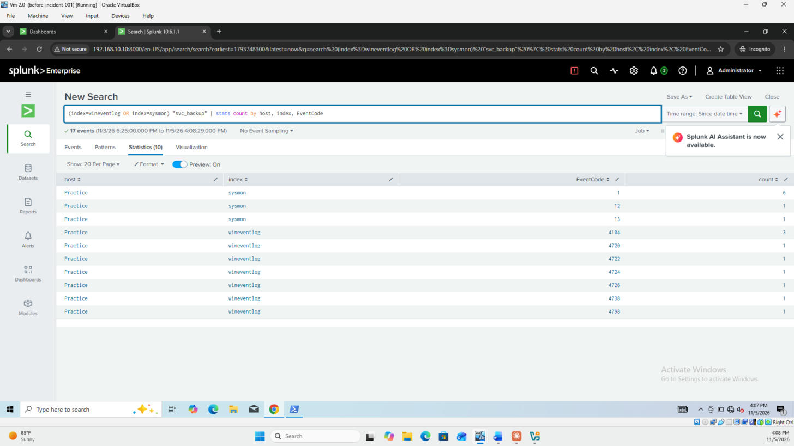
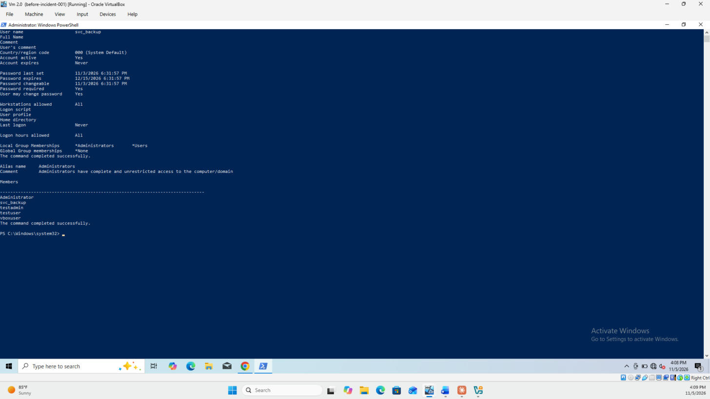
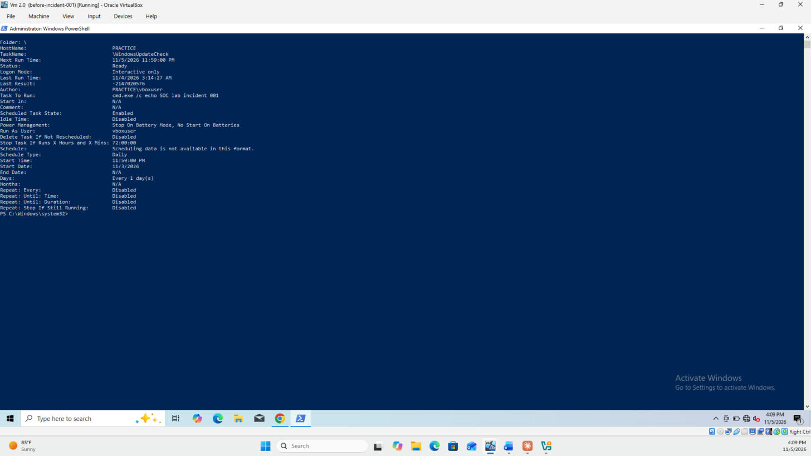
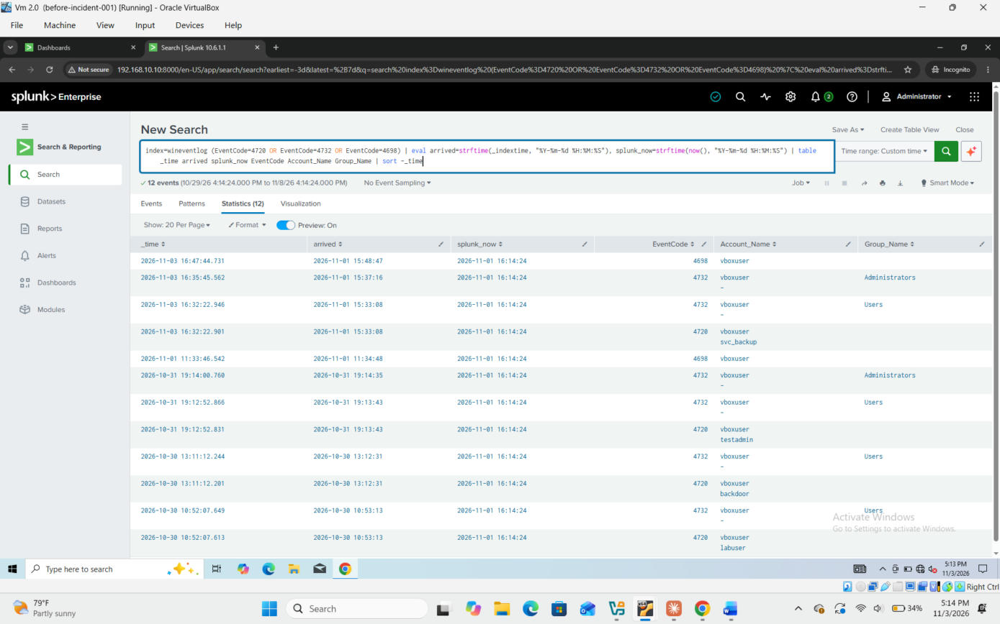
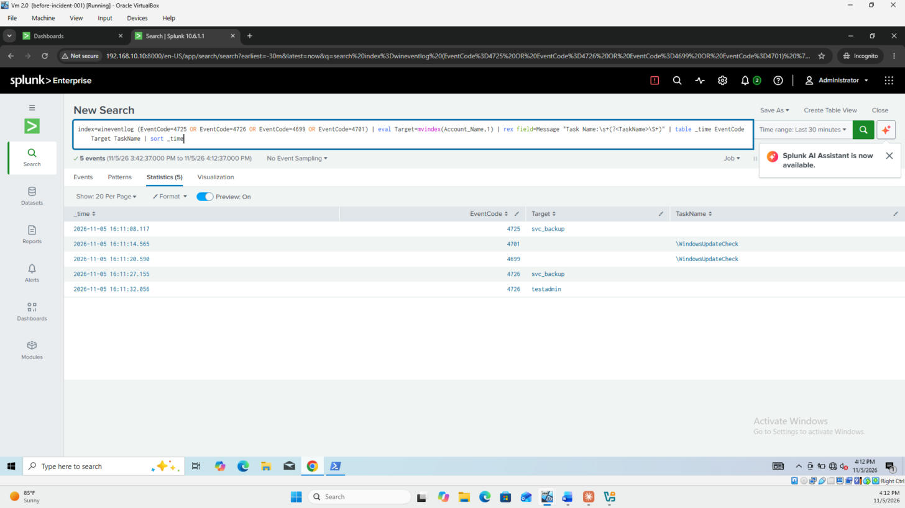
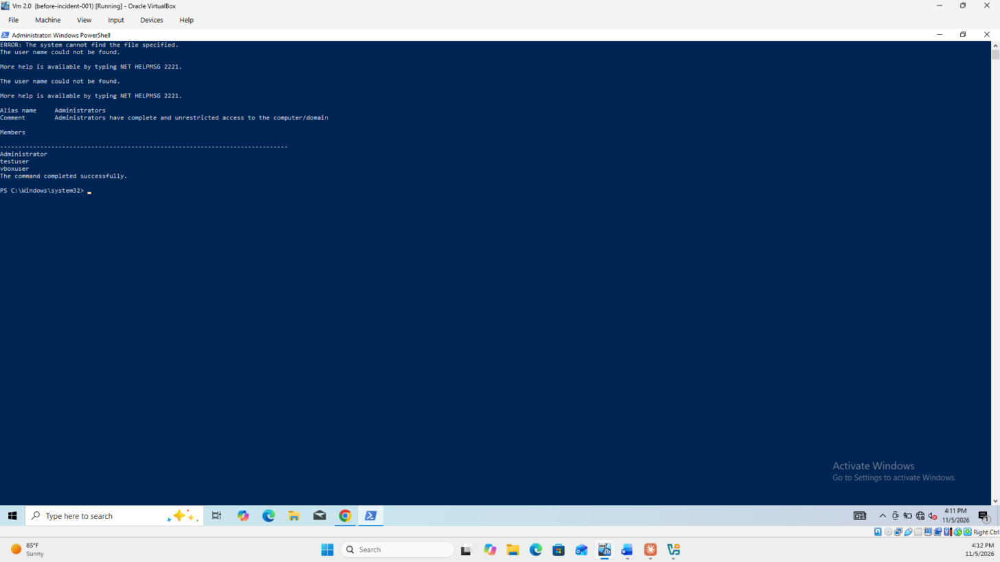

# INC-001: Unauthorized Admin Account with Persistence

> **Simulated incident.** All activity was performed deliberately in an isolated home lab for training. No real systems, users or data were affected.

| Field | Value |
|---|---|
| **Incident ID** | INC-001 |
| **Severity** | High |
| **Status** | Closed |
| **Affected host** | `Practice` (192.168.10.20), Windows 10 |
| **Account used** | `PRACTICE\vboxuser` |
| **Detected** | 2026-11-03 18:35:01 |
| **SIEM** | Splunk Enterprise 10.6 with Sysmon and Windows Event Logs |
| **Analyst** | Krish Patel |

All times are Splunk display time (EST), recorded on 2026-11-03.

---

## 1. Executive Summary

A new administrator account was created on a workstation, followed by a hidden PowerShell command and a daily scheduled task designed to look like a Windows update job. Together these actions gave the actor full control of the machine and a way to keep access. The sequence took about 10 seconds, and four security alerts identified it about three minutes later.

An earlier run of the same activity went undetected because the SIEM server's clock was about two days behind. That problem was corrected, and the alerts then worked as designed.

No evidence of spread beyond this machine, data theft or damage has been found in the available logs. The account and task were preserved as evidence, disabled and removed, and their removal was verified.

## 2. Detection

Four scheduled Splunk alerts fired during the same 18:35 run:

| Time fired | Alert | MITRE ATT&CK | Severity |
|---|---|---|---|
| 18:35:01.293 | New Local User Created | T1136.001 | Medium |
| 18:35:01.294 | User Added to Privileged Group | T1098 | High |
| 18:35:01.320 | Suspicious PowerShell Execution | T1059.001 | High |
| 18:35:01.381 | Scheduled Task Persistence | T1053.005 | High |

Several different alerts on one host in a single run suggested one connected attack, not unrelated events.

## 3. Timeline

| Time | Event | Evidence |
|---|---|---|
| 18:31:57.735 | `net user svc_backup ... /add` executed | Sysmon 1 |
| 18:31:57.754 | Account `svc_backup` created | Security 4720 |
| 18:31:57.767 | Added to **Users** (automatic for new accounts) | Security 4732 |
| 18:31:59.995 | `net localgroup Administrators svc_backup /add` executed | Sysmon 1 |
| 18:32:00.013 | Added to **Administrators** | Security 4732 |
| 18:32:02.826 | Hidden PowerShell started with `-EncodedCommand` | Sysmon 1 |
| 18:32:03.175 | Decoded script logged: `whoami; hostname; Write-Output "SOC lab incident 001"` | PowerShell 4104 |
| 18:32:08.077 | `schtasks /create /tn WindowsUpdateCheck ...` executed | Sysmon 1 |
| 18:32:08.111 | Scheduled task `WindowsUpdateCheck` created | Security 4698 |
| 18:35:01 | Four alerts fired | Splunk audit log |

**Duration:** about 10 seconds from first to last action.
**Time to detect:** 2 minutes 53 seconds after the last action.

## 4. Investigation and Analysis

**Sequence.** The order matches a common post-compromise pattern: create an account, give it administrator rights, check where you are, then set up persistence.

**Correlating log sources.** Each Sysmon process event was followed roughly 20 to 40 milliseconds later by the Windows event it caused. Sysmon shows *which command ran and who ran it*, and the Windows logs show *what changed*. Together they confirm each other.

**Separating normal from suspicious.** The first 4732 event, adding `svc_backup` to **Users**, is normal behaviour for a new account. The second, adding it to **Administrators**, is the significant one.

**Decoding the command.** The PowerShell command line contained only Base64, which is encoding and not encryption. Script Block Logging (Event 4104) recorded the decoded text, showing the commands `whoami` and `hostname`, which reveal the current user and machine.

**Deceptive names.** `svc_backup` resembles a service account, and `WindowsUpdateCheck` resembles a Windows task. A real task of that kind would normally sit under `\Microsoft\Windows\`, whereas this one was created in the root folder.

**Password exposure in logs.** Sysmon recorded the new account's password in plain text in the command line. This helps investigators, but it also means logs can hold sensitive data, so access to them should be restricted. The value here is a throwaway lab password.

### Scope assessment (checked 2026-11-05, about 16:08)

| Question | Search | Result |
|---|---|---|
| Does `svc_backup` appear on other hosts? | `(index=wineventlog OR index=sysmon) "svc_backup" \| stats count by host, index, EventCode` | **Only `Practice`** (17 events) |
| Did PowerShell make network connections during the attack? | `index=sysmon EventCode=3 Image="*powershell.exe" \| table _time Image DestinationIp DestinationPort` (18:31 to 18:40) | **None found** |
| Has `svc_backup` logged on? | `index=wineventlog EventCode=4624 "svc_backup"` | **None found.** `net user` also shows `Last logon: Never` |

**Conclusion:** the evidence shows no spread beyond `Practice`, no logons by the new account and no PowerShell network connections in the attack window.

**Limits of this conclusion:** `Practice` is the only Windows endpoint sending logs to this SIEM, so activity on an unmonitored system would not appear. Finding no Sysmon network events also relies on the Sysmon configuration recording that activity.

### Preserved evidence (collected 2026-11-05, about 16:09)

**Account `svc_backup`:** active, password set 11/3/2026 6:31:57 PM, last logon Never, member of Administrators and Users.

**Task `\WindowsUpdateCheck`:**

| Field | Value |
|---|---|
| Location | Root folder (`\`), not `\Microsoft\Windows\` |
| Author / Run as | `PRACTICE\vboxuser` / `vboxuser` |
| Task to run | `cmd.exe /c echo SOC lab incident 001` |
| Schedule | Daily at 11:59 PM, starting 11/3/2026 |
| Last run | 11/4/2026 3:14:27 AM |
| Last result | `-2147020576` (`0x800710E0`), meaning the request was refused, so this run probably did not complete. The task's power settings prevent it from starting on battery, which may be the reason; this wasn't confirmed. |
| Next run | 11/5/2026 11:59 PM |

### Other members of Administrators

When checked, the local Administrators group also contained `Administrator`, `vboxuser`, `testadmin` and `testuser`. `testadmin` was a leftover test account from earlier detection work, and `testuser` was also not part of this incident's activity as recorded in the timeline. Both were removed during cleanup. Unnecessary administrators are a risk whether or not they relate to an incident.

## 5. Detection Gap: Missed First Run

The same activity had been carried out earlier that day, between 16:32:22 and 16:47:44. **No alerts fired.**

| Observation | Value |
|---|---|
| Real time when checked | 2026-11-03, about 17:14 |
| Splunk server clock (`now()`) | 2026-11-01 16:14:24 |
| Clock error | About 2 days 1 hour behind |
| `svc_backup` created (event time) | 2026-11-03 16:32:22 |
| Same event received (Splunk's clock) | 2026-11-01 15:33:08 |

Windows stamped the events with the correct date, while the Splunk server believed it was two days earlier. The events therefore appeared to be in the future. Alerts searching "the last 5 minutes" could not see them, and neither could normal searches ending at "now".

While troubleshooting, the server's time sync showed no server contacted, and name resolution was failing, so it could not reach a time server. After the VM was restarted and time sync was re-enabled, the clock was confirmed as synchronized. The second run then triggered all four alerts. The exact trigger for the network failure was not confirmed.

## 6. Indicators of Compromise

| Type | Value |
|---|---|
| Account | `svc_backup` |
| Scheduled task | `\WindowsUpdateCheck` |
| Task action | `cmd.exe /c echo SOC lab incident 001` |
| Encoded command | `dwBoAG8AYQBtAGkAOwAgAGgAbwBzAHQAbgBhAG0AZQA7ACAAVwByAGkAdABlAC0ATwB1AHQAcAB1AHQAIAAiAFMATwBDACAAbABhAGIAIABpAG4AYwBpAGQAZQBuAHQAIAAwADAAMQAiAA==` |
| PowerShell flags | `-NoProfile -WindowStyle Hidden -EncodedCommand` |

No external IP addresses, domains or malicious files have been identified so far.

## 7. MITRE ATT&CK Mapping

| Tactic | Technique | Observed behaviour |
|---|---|---|
| Persistence | T1136.001 Create Account: Local Account | `svc_backup` created |
| Persistence, Privilege Escalation | T1098 Account Manipulation | Account added to Administrators |
| Execution | T1059.001 PowerShell | Encoded PowerShell command run |
| Defense Evasion | T1027 Obfuscated Files or Information | Base64-encoded command |
| Defense Evasion | T1564.003 Hidden Window | `-WindowStyle Hidden` |
| Discovery | T1033 System Owner/User Discovery | `whoami` |
| Discovery | T1082 System Information Discovery | `hostname` |
| Execution, Persistence | T1053.005 Scheduled Task | `WindowsUpdateCheck` created |

## 8. Root Cause

**Initial access is out of scope.** The simulation began from an existing administrator session, so the logs do not show how an attacker would have obtained `vboxuser`'s access. In a real incident, this account would be treated as compromised, and the investigation would review its recent logons, sources and any phishing or credential exposure.

**The detection failure** on the first run was caused by the SIEM server's clock, which was not synchronized.

## 9. Containment and Remediation

| Step | Action | Command or check | Status |
|---|---|---|---|
| 1. Preserve | Save task and account details | `schtasks /query /tn WindowsUpdateCheck /v /fo list`, `net user svc_backup` | **Done** 2026-11-05, about 16:09 |
| 2. Contain | Disable the account and the task | `net user svc_backup /active:no`, `schtasks /change /tn WindowsUpdateCheck /disable` | **Done**, see below |
| 3. Remove | Delete the task and the account | `schtasks /delete /tn WindowsUpdateCheck /f`, `net user svc_backup /delete` | **Done**, see below |
| 4. Close the way in | Reset the password of `vboxuser` | In a real incident only; skipped in this lab to avoid lockout | **Recommendation** |
| 5. Verify | Confirm that the task and account are gone | Task query and `net user` both returned "not found"; Administrators no longer lists `svc_backup` | **Done** 2026-11-05, about 16:12 |

The containment actions were themselves logged, which gives an audit trail:

| Time (2026-11-05) | Event | Target |
|---|---|---|
| 16:11:08.117 | 4725 Account disabled | `svc_backup` |
| 16:11:14.565 | 4701 Task disabled | `\WindowsUpdateCheck` |
| 16:11:20.590 | 4699 Task deleted | `\WindowsUpdateCheck` |
| 16:11:27.155 | 4726 Account deleted | `svc_backup` |
| 16:11:32.056 | 4726 Account deleted (leftover test account) | `testadmin` |

**Detection to containment:** about 45.5 hours, from 2026-11-03 18:35:01 to 2026-11-05 16:11:08. This reflects a home lab worked on part-time. A real SOC would treat a new administrator account with far more urgency, and an attacker could have used the account during this time.

**Follow-up cleanup:** `testuser` was deleted at 16:14:08.593 by `vboxuser` (Event 4726). A final check confirmed that Administrators contains only `Administrator` and `vboxuser`, and that `testuser` no longer exists. The account's creation time was not established, because the search for it covered only the preceding 30 minutes.

## 10. Recommendations and Lessons Learned

**Prevent**
- Limit who holds local administrator rights.
- Use separate accounts for administration and daily work.

**Detect**
- Correlate a 4720 and a 4732 for the same account within minutes into a single higher-severity alert.
- Alert when events' timestamps differ greatly from when they arrived, to catch clock drift and logging delays.
- Consider running the most critical alerts more often. The attack finished in about 10 seconds, while alerts ran every 5 minutes.

**Harden the SIEM**
- Monitor the time sync status of the SIEM server and log sources.
- Run Splunk under a dedicated low-privilege account instead of root.
- Restrict access to logs, since command lines can contain passwords.

**Lessons learned**
- A detection is only as reliable as its data. Correct rules still failed silently when the clock was wrong.
- Test detections end to end, not just once, and recheck them after infrastructure problems.
- Using more than one log source filled gaps: Sysmon showed the commands, and 4104 showed the decoded content.
