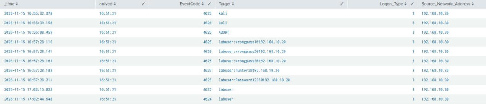
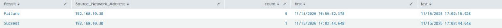

# INC-002: SMB Brute-Force from an Internal Host (Successful)

> **Simulated incident.** All activity was performed deliberately in an isolated home lab for training. The "attacker" is a Kali VM on the lab network. No real systems, users or data were affected.

| Field | Value |
|---|---|
| **Incident ID** | INC-002 |
| **Severity** | High |
| **Status** | Closed |
| **Affected host** | `Practice` (192.168.10.20), Windows 10 |
| **Source host** | 192.168.10.30 (Kali, the attacker) |
| **Targeted account** | `labuser` |
| **Detected** | After the fact, by analyst review (no alert fired — see Section 5) |
| **SIEM** | Splunk Enterprise 10.6 with Windows Event Logs |
| **Analyst** | Krish Patel |

All times are Windows event time (the timestamp Windows recorded), 2026-11-15.

---

## 1. Executive Summary

Another computer on the internal network repeatedly tried to log in to a workstation over SMB (Windows file sharing), guessing passwords for the `labuser` account. After nine failed attempts in about seven minutes, one attempt succeeded, giving the source machine access to administrative shares (`ADMIN$`, `C$`, `IPC$`) on the target.

The activity was **not caught by any alert**. The analyst found it by reviewing the logs directly. The investigation showed two detection gaps: the SIEM server's clock had drifted behind real time, and the brute-force rule groups by account name in a way the attempts did not match. Grouping by **source IP address** instead makes the attack obvious.

## 2. Detection

**No alert fired for this incident.** A search of Splunk's audit log (`index=_audit action=alert_fired`) over the attack window returned nothing. The attack was identified during manual log review. Section 5 explains why the existing brute-force detection missed it.

## 3. Timeline

All events are Windows Security log entries, **Logon Type 3 (network)**, with source address **192.168.10.30**.

| Time | Event | Target account as recorded | Result |
|---|---|---|---|
| 16:55:32 | 4625 | `kali` | Failure |
| 16:55:39 | 4625 | `kali` | Failure |
| 16:56:08 | 4625 | `ABORT` | Failure |
| 16:57:28.116 | 4625 | `labuser:wrongpass1@192.168.10.20` | Failure |
| 16:57:28.141 | 4625 | `labuser:wrongpass2@192.168.10.20` | Failure |
| 16:57:28.163 | 4625 | `labuser:wrongpass3@192.168.10.20` | Failure |
| 16:57:28.188 | 4625 | `labuser:hunter2@192.168.10.20` | Failure |
| 16:57:28.211 | 4625 | `labuser:Password123!@192.168.10.20` | Failure |
| 17:02:15 | 4625 | `labuser` | Failure |
| **17:02:44** | **4624** | **`labuser`** | **Success** |

**Summary:** 9 failed logons, then 1 successful logon, all from 192.168.10.30, spanning 16:55:32 to 17:02:44 (about 7 minutes).





## 4. Investigation and Analysis

**The source.** Every event carries `Source_Network_Address = 192.168.10.30` and `Logon_Type = 3`. Logon Type 3 means a network logon (SMB in this case), not someone sitting at the keyboard. This immediately tells the analyst the activity came from another machine on the network, and names it.

**The pattern.** Many failures followed by a success, from one source, against one host, in a few minutes, is the signature of a brute-force (password-guessing) attack that eventually worked.

**What the odd account names mean.** Several failures were recorded against unusual "account" strings such as `kali`, `ABORT` and `labuser:wrongpass1@192.168.10.20`. These are artifacts of how the attacking tool passed its credentials; Windows logged whatever username string it received. The important point for an analyst is that the *real* target was `labuser`, and the source was always the same IP. Relying on the account-name field alone would scatter this one attack across many "different" accounts.

**The successful logon.** The 4624 at 17:02:44 is for `labuser`. During the attack the source listed the shares `ADMIN$`, `C$` and `IPC$`. `ADMIN$` and `C$` are administrative shares that only an **administrator** can reach, so `labuser` holds local administrator rights, and the attacker now has network access to the whole disk of the target.

**The attack tool.** Older SMB brute-force tools (hydra's SMB module) failed with "invalid reply from target" because modern Windows requires SMB2/SMB3, which that module does not speak. The attempts that actually reached Windows used `smbclient`, which negotiates SMB3. This is itself a useful lesson: an attack can fail or succeed purely on protocol support, and "errors" on the attacker side do not always mean nothing reached the target.

### How this *should* be detected
Grouping the same events by source IP removes the account-name noise and shows the attack plainly:

```spl
index=wineventlog EventCode=4625 Logon_Type=3
| stats count AS failures by Source_Network_Address
| where failures >= 5
```

This returns 192.168.10.30 with 9 failures — one clear result. A companion search links failures to a later success from the same source:

```spl
index=wineventlog (EventCode=4625 OR EventCode=4624) Logon_Type=3 Source_Network_Address="192.168.10.30"
| stats count(eval(EventCode=4625)) AS failures count(eval(EventCode=4624)) AS successes by Source_Network_Address
| where failures >= 5 AND successes > 0
```

## 5. Why the Existing Detection Missed It

The [brute-force detection (T1110)](https://github.com/Krishpatel175/soc-home-lab/blob/main/detections/T1110-brute-force.md) did not fire. Two separate causes:

1. **Account-name grouping.** That rule groups by the targeted account and fires on 5+ failures for the *same* account in 5 minutes. Because the attempts arrived under many different account-name strings, no single account reached 5 failures. **Grouping by source IP would have caught it.** This is a real tuning weakness: an attacker who varies the username (or whose tool mangles it) slips past account-based thresholds.
2. **SIEM clock drift.** As in [INC-001](INC-001-unauthorized-admin-persistence.md), the Splunk server's clock was running about 15 minutes behind real time during this exercise. The scheduled alert searches "the last 5 minutes" by event time, so events stamped in what Splunk still considered the future were never in range. Normal searches also returned nothing until the time window was widened into the future.

Both are worth fixing. The clock problem silences *every* time-based detection; the grouping problem silences this specific rule against a simple evasion.

## 6. Indicators of Compromise

| Type | Value |
|---|---|
| Source IP | 192.168.10.30 |
| Targeted account | `labuser` |
| Logon type | 3 (network / SMB) |
| Protocol / port | SMB over TCP 445 |
| Pattern | 9× Event 4625 then 1× Event 4624 from one source in ~7 minutes |
| Accessed shares | `ADMIN$`, `C$`, `IPC$` |

## 7. MITRE ATT&CK Mapping

| Tactic | Technique | Observed behaviour |
|---|---|---|
| Credential Access | T1110.001 Brute Force: Password Guessing | Repeated SMB logon attempts against `labuser` |
| Lateral Movement | T1021.002 Remote Services: SMB/Windows Admin Shares | Access to `ADMIN$` / `C$` over SMB |
| Defense Evasion / Persistence | T1078 Valid Accounts | Successful logon using guessed valid credentials |

## 8. Root Cause

The `labuser` account had a weak, guessable password (`Password123!`) and held local administrator rights, and the host accepted inbound SMB (TCP 445) from the lab network. Together these let a network peer guess the password and reach the administrative shares. (SMB sharing was enabled on the target for this exercise; the firewall rule that allowed it is noted in Remediation.)

## 9. Containment and Remediation

| Step | Action | Status |
|---|---|---|
| Contain | Reset `labuser` to a strong password, or disable the account | **Recommended** (lab account left in place for further exercises) |
| Contain | Remove `labuser` from local Administrators if it does not need it | **Recommended** |
| Harden | Restrict inbound SMB (TCP 445) so only expected hosts can connect; the lab rule `Enable-NetFirewallRule -DisplayGroup "File and Printer Sharing"` opened it | **Recommended** |
| Harden | Enable an account lockout policy so repeated failures lock the account (and generate Event 4740) | **Recommended** |

Because this is a training lab, the account and SMB exposure were left in place rather than fully remediated; the actions above are what a real response would perform.

## 10. Recommendations and Lessons Learned

**Detection**
- Add a brute-force rule keyed on **source IP** (5+ Event 4625 of Logon Type 3 from one address in 5 minutes), not just account name.
- Add a high-severity rule for **failures followed by a success** from the same source (the "brute-force succeeded" case).
- Alert on Event **4740** (account lockout) once a lockout policy exists.

**Infrastructure**
- Fix and monitor the SIEM server's time synchronisation; clock drift silently disabled every scheduled detection here, the second incident in a row affected by it.

**Hardening**
- Enforce strong passwords and account lockout.
- Limit which hosts may reach SMB, and avoid giving everyday accounts local administrator rights.

**Lessons learned**
- Group detections by the most reliable field. Account names can be varied or mangled; the source IP was constant and gave one clean signal.
- A successful logon (4624) right after a burst of failures (4625) from the same source is the single most important thing to catch in a brute-force — it marks the moment of compromise.
- Log timestamps underpin everything. For the second time, a drifted SIEM clock caused real detections to miss a real attack.
